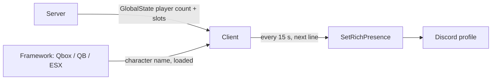

<div align="center">



<br>


**Your server in every player's Discord profile.**
Logo, two buttons and a line that rotates between what the player is doing, their character and the player count, in the player's own language.

[Features](#-features) · [How it works](#-how-it-works) · [Installation](#-installation) · [Configuration](#-configuration) · [License](#-license)

</div>

---

## ✨ Features

<table>
<tr>
<td width="50%" valign="top">

### 🎮 Live activity
"Driving on Vinewood Blvd, Vinewood", "Riding along on…", "Flying over Sandy Shores", "Swimming in…", "Waiting for the paramedics". Real GTA zone and street names, a different text per vehicle class.

### 👤 Character and players
Character name and server ID, plus the real player count and slots from the server (not only the players around you).

### 🌐 Player's language
Spanish or English picked from the player's GTA V language, or forced in the config.

</td>
<td width="50%" valign="top">

### 🔘 Buttons and images
Large and small image from your Discord app's Art Assets, up to two buttons (`https://` or `fivem://`, anything else is ignored with a warning).

### 🧩 Any framework
Qbox, QBCore, ESX or standalone, detected at runtime. No fxmanifest dependencies, no tables, no items.

### 🚑 Ambulance systems
Death check reads `wasabi_ambulance` or `qbx_medical` when running, the native death state otherwise. One function in `config.lua` to plug in yours.

</td>
</tr>
</table>

## 🔄 How it works



The server publishes the player count and `sv_maxclients` in `GlobalState` (clients cannot read them), updated when players join or leave. The client sets the app, images and buttons once, then every `Config.UpdateInterval` renders the next line of `Config.Lines` and only sends it to Discord when the text changed.

<details>
<summary>📁 Project structure</summary>

```text
better_discord_rpc/
├── config.lua          AppId, images, buttons, rotating lines, IsPlayerDead()
├── client.lua          framework detection, activity, placeholders, presence loop
├── server.lua          player count and slots in GlobalState
├── locales/            es.lua, en.lua
└── assets/readme/      banner
```

</details>

## 🚀 Installation

1. Create an app at <https://discord.com/developers/applications> (its name is what Discord shows as "Playing …"). Copy **General Information → Application ID**.
2. Upload your images in **Rich Presence → Art Assets** (512×512 minimum). They can take a few minutes to show up.
3. Put `better_discord_rpc` in your resources, `ensure better_discord_rpc`, and fill `config.lua`.
4. **Qbox:** turn off the built-in presence in `qbx_core/config/client.lua` → `discord.enabled = false`. Only one resource can own the rich presence.

No dependencies, no SQL, no items.

## ⚙️ Configuration

| Option | What it does |
|---|---|
| `Config.AppId` | Discord Application ID. Until it is set the script does nothing (warning in F8) |
| `Config.Locale` | `'auto'` (player's GTA language), `'es'` or `'en'` |
| `Config.UpdateInterval` | ms between lines, minimum 5000 (Discord throttles faster updates) |
| `Config.LargeImage` / `SmallImage` | `name` = asset name in Art Assets, `text` = hover text. `name = ''` hides it |
| `Config.Buttons` | Up to 2 `{ text, url }`, url must start with `https://` or `fivem://` |
| `Config.Lines` | Lines shown one after another |
| `Config.IsPlayerDead()` | Death check for the "waiting for the paramedics" text |

Placeholders for `Config.Lines`: `{activity}` `{charName}` `{playerName}` `{id}` `{players}` `{maxPlayers}` `{playersWord}` `{zone}` `{street}`.

<details>
<summary>🛠️ Operation notes</summary>

- After changing the AppId players must reconnect: FiveM keeps the previous app until it restarts.
- Discord does not show your own buttons on your own profile; other people see them.
- Another program using Discord Rich Presence (for example a VS Code extension) can take the "Playing" slot on your own profile. Other players still see the server.
- Without a framework the character name falls back to the FiveM player name.

</details>

## 📄 License

Released under the **MIT License** — free to use, modify and share, keeping the copyright notice. See [`LICENSE`](LICENSE).

© 2026 JVL Customs · JVL MediaCode

---

<div align="center">

Made by **[JVL MediaCode](https://jvlmediacode.com)** · Jose M. Valenzuela · Meoqui, Chihuahua, México

<sub><a href="mailto:contacto@jvlmediacode.com">contacto@jvlmediacode.com</a> · <a href="https://discord.gg/m2spgxkPfj">Discord</a></sub>

</div>
